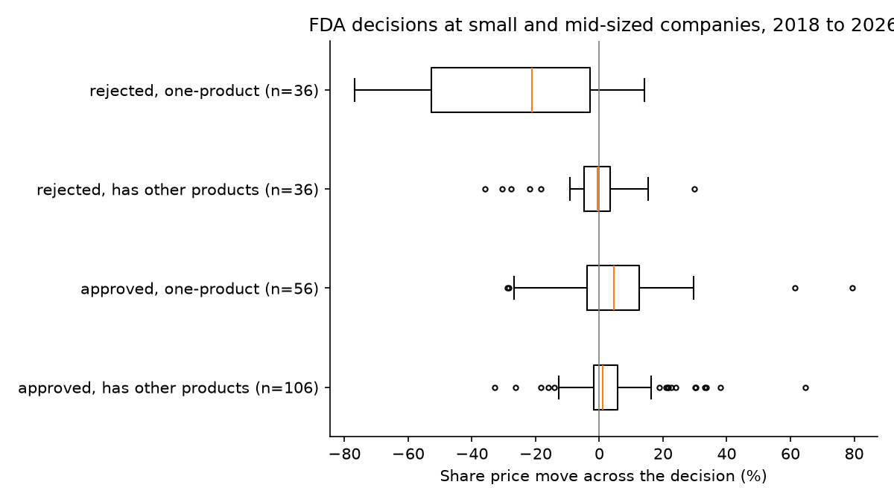
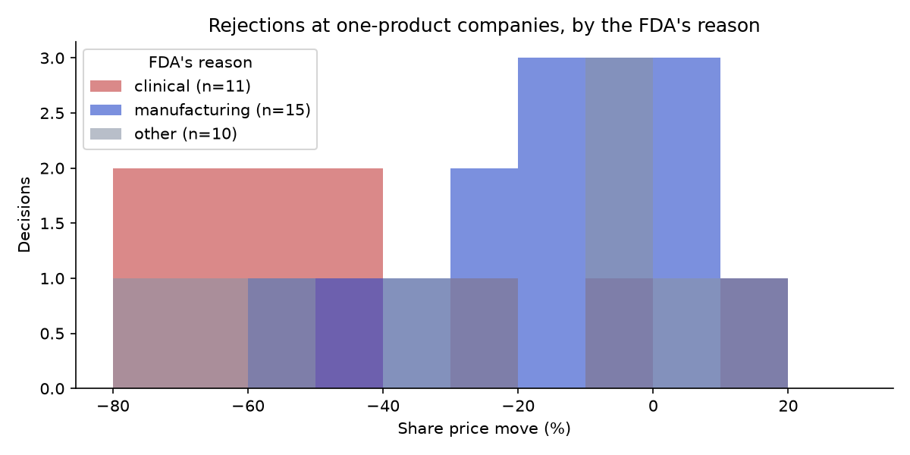

# FDA Implied Moves

Do options markets correctly price how far a biotech share moves on an FDA drug decision? This project measures that against history and paper trades the difference.

## The idea

An FDA decision is a near-binary event with a known date. Option traders price that risk in. A **straddle** (one call and one put at the same strike, at the current share price) pays off if the share moves a lot in either direction, so its price is roughly the move the market expects:

```
implied move ≈ (call price + put price) / share price
```

The tool judges that price in several ways and takes a paper trade only when they agree:

| | Measure | What it asks |
|---|---|---|
| A | Average | Is the implied move bigger than the average move on similar past decisions? |
| B | Distribution | In what share of similar past decisions was the move bigger than the options need? |
| C | Term structure | What do options expiring before and after the decision say the decision alone is worth? |
| D | Implied odds | What chance of approval would make history agree with the option price? (shown, does not vote) |
| Guard | Out of range | Is the implied move beyond 95% of similar past decisions? If so, no trade. |

It sells the straddle if at least two of A, B and C say expensive and none says cheap, buys if the reverse, and otherwise does nothing.

## The history

`fetch_fda.py` downloads every decision since 2018 from the FDA's own public data: approvals from Drugs@FDA and rejections from the FDA's published Complete Response Letters. `build_history.py` matches them to listed companies and measures the share price move across each decision.

Current dataset: **488 decisions across 123 companies** (`data/history.csv`).

| Outcome | Company size | Decisions | Average size of move | Average direction | Worst | Best |
|---|---|---|---|---|---|---|
| Approved | Small (under $2bn) | 73 | 13.5% | +4.9% | -32.8% | +79.4% |
| Approved | Mid ($2bn to $20bn) | 89 | 6.4% | +2.9% | -26.2% | +38.1% |
| Approved | Large (over $20bn) | 228 | 2.1% | +0.5% | -14.2% | +38.2% |
| Rejected | Small | 39 | 28.5% | -22.6% | -76.8% | +29.8% |
| Rejected | Mid | 33 | 8.5% | -4.4% | -43.8% | +14.7% |
| Rejected | Large | 26 | 2.1% | -1.2% | -10.8% | +5.0% |

**How much the company depends on the drug matters most.** Using the FDA's full approval record, each decision is tagged by whether the company already had an approved product:

| Outcome | Company | Decisions | Average size of move | Average direction |
|---|---|---|---|---|
| Rejected | Small, no other product | 28 | 35.5% | -32.5% |
| Rejected | Small, has other products | 11 | 10.5% | +2.5% |
| Approved | Small, no other product | 34 | 15.0% | +4.6% |
| Approved | Small, has other products | 39 | 12.3% | +5.2% |

Each move is also stored as a **multiple** of the share's normal daily movement in the 60 trading days before the decision. A small company's rejection is on average about 6 normal days' worth of movement in one day.



**Why the FDA says no matters too.** Read from the section headings of its rejection letters:



## Testing the model

`analysis.py` fits each version of the model on decisions before 2023 and forecasts the size of the move for 2023 onwards. Small and mid-sized companies:

| Version | Average error (points) | Bias (points) | Rank correlation |
|---|---|---|---|
| v0: flat average | 10.79 | -5.82 | 0.28 |
| v1: scaled by the share's normal movement | 9.78 | -2.95 | 0.57 |
| v2: + company size | 10.69 | -0.72 | 0.55 |
| v3: + dependence on the drug | 10.46 | -1.06 | 0.57 |
| **v4: + second attempt and reason, with shrinkage** | 10.12 | +0.75 | 0.56 |
| v5: + run-up before the decision | 10.03 | +0.79 | 0.56 |

Scaling by the share's own movement was the one large gain. The later factors removed the bias, which matters for pricing a straddle, but did not reduce the average error. Version 4 is in use. New molecule, priority review and run-up were tested and left out. Full tables, a walk-forward test and confidence intervals are in [results/analysis.md](results/analysis.md), and the reasoning is in [JOURNAL.md](JOURNAL.md).

## How the expected move is calculated

```
event move    = (P(approve) x approval multiple + P(reject) x rejection multiple) x this share's normal daily move
normal wobble = 0.8 x normal daily move x sqrt(other trading days until expiry)
expected move = sqrt(event move^2 + normal wobble^2)
```

The multiples come from past decisions of the same company size and dependence, refined by whether the drug was rejected before (for approvals) and the likely reason (for rejections). Small groups are blended with wider ones in proportion to how many examples they have (`model.py`). The probability of approval is my own input for each decision, based on the trial data and mechanism. That is where the biology comes in. The tool prints recent headlines for the company to help set it.

## Usage

```bash
pip install -r requirements.txt
python fetch_fda.py        # download FDA decisions
python build_history.py    # measure past moves and build the model

python analysis.py         # factor tests, backtests and charts

python implied_move.py model
python implied_move.py signal  TICKER 2026-12-15 --p-approve 0.7 --dependence high --second-attempt --risk clinical
python implied_move.py trade   TICKER 2026-12-15 --p-approve 0.7 --dependence high --drug "name" --note "why"
python implied_move.py positions
python implied_move.py outcome TICKER 2026-12-15 --note "approved"
python implied_move.py summary
```

`--dependence high` means the company has no other approved product; `low` means it already sells drugs. `summary` shows open positions and a scorecard of whether my forecast or the market's was closer on each finished decision. Research notes on upcoming decisions are in `research/`, and the development history is in `JOURNAL.md`.

Paper trades are saved in `trades.csv`. A seller enters at the bid and exits at the ask, and a buyer the reverse, so trading costs are included.

## Limitations

- **Most of the move is unpredictable:** the best version is still off by about 10 points on average.
- **Options looked dearer than history on every decision tried so far.** That points to a systematic gap, not repeated mispricing, so "expensive" alone is weak evidence.
- **The measures are not independent:** A, B and D all draw on the same history. C is separate but has not yet had quotes tight enough to work.
- **Survivorship:** companies that were acquired or delisted have no free price data and are missing. Many of the biggest winners and losers are among them.
- **Rejections are incomplete:** the FDA has published only some of its rejection letters, so the mix of approvals and rejections in the data is not the true rate. That is why the probability of approval is an input rather than taken from the data.
- **Company size is rough:** it uses today's share count with the share price at the time.
- **Decision dates:** the FDA action date is used. Companies sometimes announce a day later; the before-and-after window covers that.
- **No options backtest:** free data gives current option prices only, so the trading rule can only be tested going forward.
- **Tail risk:** selling straddles wins small and often, then loses big on a surprise. Results must be read with the worst case in mind.
- **Averages hide a lot:** two decisions in the same group can move very differently.

This is a research project with paper trades only. It is not investment advice.

## Status

Model at version 4, backtested out of sample. Collecting paper trades on upcoming decisions.

Built with Claude as a coding assistant.
